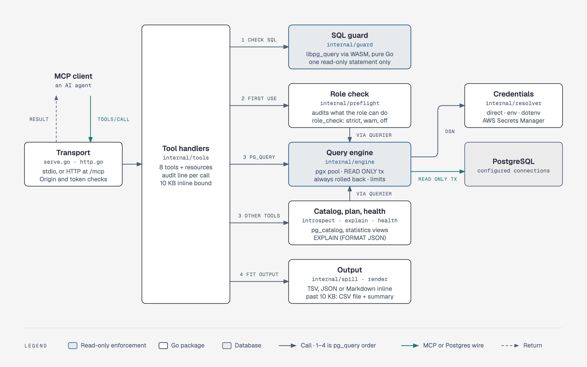

# How it's built

pgglass is one Go binary, built without cgo. The packages under `internal/` each do one thing, and a tool call passes through them as below.

<picture><source media="(prefers-color-scheme: dark)" srcset="assets/diagrams/architecture-dark.png"></picture>

## Packages

Each line follows the package's doc comment; `config` and `resolver` have none, so theirs follow the doc comments of their types.

| Package | What it does |
|---------|--------------|
| `main` | The command: flags and `pgglass doctor` (`main.go`, `doctor.go`), wiring and serving over stdio (`serve.go`), and serving over Streamable HTTP with its token and origin checks (`http.go`). |
| `internal/tools` | Implements the MCP tools and the table resources, `pgglass://<connection>/<schema>/<table>`. Every tool failure is a tool result with `IsError` set, and every tool call and resource read writes one JSON audit line, or one per connection when `pg_query` fans out or the resources are listed, that holds no SQL text, parameter or value. |
| `internal/guard` | Rejects SQL that is not a single read-only statement, using the Postgres parser (libpg_query, through the pure-Go `github.com/wasilibs/go-pgquery`) rather than keyword matching; it also rejects what would act outside the `READ ONLY` transaction or survive its rollback, and reads of the catalogs that hold server configuration files or credentials. `guard/guardtest` holds its corpus. |
| `internal/preflight` | Audits what the role behind a connection can do beyond reading, so a connection that is not truly read-only is refused or flagged (`role_check`: `strict`, `warn` or `off`). |
| `internal/engine` | Runs read-only queries against the configured connections: each alone in a `READ ONLY` transaction that is always rolled back, under timeouts and result limits. |
| `internal/resolver` | Resolves a connection's DSN through the `CredentialSource` registered for its `source` type, one implementation per type (`direct`, `env`, `dotenv`, `aws_secrets_manager`), each registering itself in `init()`. |
| `internal/render` | Turns a query result into text for tool output and spill files, as TSV, CSV, Markdown or JSON; every format keeps SQL `NULL` apart from the empty string. |
| `internal/spill` | Keeps tool output small: a result too large to return inline is written to a CSV file, and the tool returns a short summary instead. |
| `internal/introspect` | Describes database objects from the system catalogs as compact text for agents, reading `pg_catalog` through the engine with `search_path` pinned to `pg_catalog`, and only what the current role can read. |
| `internal/explain` | Summarizes the plan of one `SELECT` in a few lines instead of `EXPLAIN`'s output: the total cost, the nodes that cost the most by themselves, and flags for what is worth a look. |
| `internal/health` | Checks a server from its statistics views and catalogs: connections, long-running queries and transactions, blocked sessions, cache hit ratio, dead rows, unused indexes, transaction ID wraparound and replication lag. |
| `internal/config` | The config file's structure: `Config`, the `Defaults` shared by all connections, and each named `Connection` with its credential source; defaults are filled in and every setting validated, and a key it does not know is an error. |
| `internal/result` | Holds a query result as Postgres prints it, so every type (`uuid`, `numeric`, `jsonb`, arrays, ...) keeps its exact text form. |
| `internal/bench` | Measures what pgglass puts in an agent's context: the tool definitions of `tools/list`, the instructions of `initialize`, and the response to each of ten agent questions, through the MCP in-memory transport. |
| `internal/testdb` | Gives integration tests a disposable Postgres server: one container per test binary, with two fixture databases. |

## The life of a call

A `pg_query` call on one connection:

1. **In.** The MCP Go SDK reads the `tools/call` request over stdio, or over Streamable HTTP once the request has passed the `Origin`, token and `Host` checks (see [Streamable HTTP](configuration.md#streamable-http)).
2. **Arguments.** `internal/tools` decodes the arguments, refusing one it does not know, and looks the connection up in the config.
3. **Guard.** `internal/guard` parses `sql` with the Postgres parser and refuses anything but one `SELECT`, `EXPLAIN` of one or `SHOW`, and any call to a denied function or read of a denied catalog. The `search_path` the call would run under is checked next.
4. **Confirmation and role check.** On a connection with `confirm`, the client asks the user. On the connection's first use, `internal/preflight` audits its role through the engine: under `strict`, a critical finding refuses the call; under `warn`, the findings start the response.
5. **Query.** `internal/engine` takes a database connection from the connection's pool, opened with a DSN that `internal/resolver` resolves and with `default_transaction_read_only=on`. It begins a `READ ONLY` transaction, sets the timeouts, `standard_conforming_strings` and `search_path` for that transaction only, reads rows up to `max_rows` and `max_bytes`, and rolls back.
6. **Output.** `internal/spill` renders the rows with `internal/render`. When they would take more than 10 KB, it writes them to a CSV spill file and returns a summary instead.
7. **Audit and reply.** `internal/tools` writes the call's JSON audit line to stderr, then returns the text, or the error as a result with `isError` set.

The other tools follow the same path. `pg_explain` checks the agent's `SELECT` the same way, wraps it in `EXPLAIN` and summarizes the plan with `internal/explain`; `pg_schema`, `pg_search`, `pg_profile`, `pg_diff_schema` and `pg_health` run only SQL the server writes, through `internal/introspect` or `internal/health`.

## How it is tested

- **Against real PostgreSQL.** Integration tests run against a throwaway Postgres container that `internal/testdb` starts with testcontainers-go, one per test package. Its fixtures hold every column type, index, constraint and object kind the server must handle, including a 20,000-row table, row-level security, a view, a materialized view and the `dblink` extension. CI runs the whole suite, `go test -race ./...`, on PostgreSQL 15, 16, 17 and 18 (`postgres:<version>-alpine`). Without Docker the integration tests fail rather than skip.
- **The guard's corpus.** `internal/guard/guardtest` holds 258 statements the guard must reject, such as a second statement hidden behind a comment or a quoted literal, and 76 reads it must allow. The guard's unit tests run it, and an end-to-end test sends every rejected statement through `pg_query`, connected as a superuser to two databases, and checks that each is refused and audited as `guard_reject`, and that the catalogs and table row counts it records in both databases did not change.
- **Fuzzing.** `FuzzCheck` checks that the guard never panics, that every error it returns is its own violation, and that whatever it accepts parses to exactly one allowed statement; its seeds are the corpus. `go test` runs the seeds, and `go test -fuzz=FuzzCheck ./internal/guard` fuzzes from them. `FuzzNestingBound` checks the depth bound the guard puts on what it parses, and `internal/render` has a fuzz target for each format.
- **Token budget.** `internal/bench` asks its ten questions of the fixture and fails when a response grows more than 10% past its baseline, or `tools/list` past 6,000 bytes. It runs with every other test, so CI checks it on each PostgreSQL version (see [Token benchmark](benchmark.md)).
- **Coverage.** At v1.0.0, `go test -race -coverprofile=cover.out ./...` against PostgreSQL 17 covered 98.3% of statements (`go tool cover -func=cover.out`), each package counted by its own tests (measured on 2026-10-14).
- **Packaging.** Tests build the binary and stop it with signals, run `install.sh` against a fake release, check that `server.json` names the image of its version, and check that every action the workflows use is pinned to a commit SHA.
- **Lint and known vulnerabilities.** CI runs golangci-lint v2.14 with the linters in [`.golangci.yml`](../.golangci.yml), among them `gosec`, `staticcheck` and `errcheck`, and `govulncheck`, which fails when the code reaches a function with a known vulnerability.
- **Release builds.** CI builds the four release targets with `CGO_ENABLED=0`, checks `.goreleaser.yml`, and runs `shellcheck` on `install.sh`.
- **Release provenance.** Each release publishes an SPDX SBOM per archive, `checksums.txt`, and build-provenance attestations signed with Sigstore for every file in `checksums.txt` and for the image, which has an SBOM attestation too. `gh attestation verify` checks them (see [Releasing](releasing.md)).
