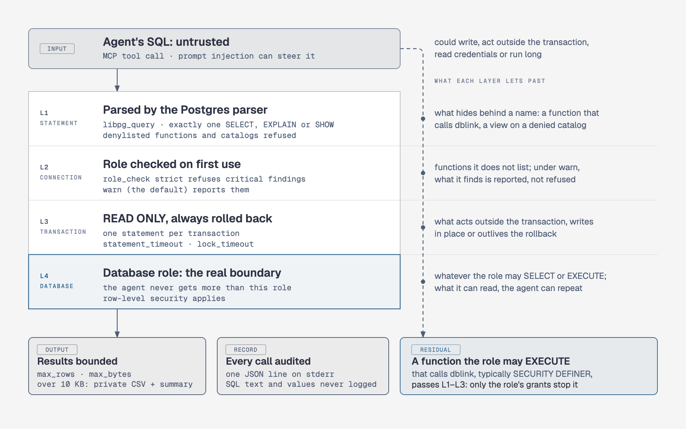

# Safety model

<picture><source media="(prefers-color-scheme: dark)" srcset="assets/diagrams/safety-layers-dark.png"></picture>

The calling agent is treated as untrusted: instructions can reach it through the data it reads (prompt injection). These layers hold whatever SQL it sends.

## The layers

1. **The database role is the real boundary.** The server never gives the agent more than the role it connects as, so connect as a role that can read only what the agent should see. Row-level security applies as usual.
2. **The role is checked.** On a connection's first use, the server audits what its role can do beyond reading, and its session user too when the connection sets another role, since `RESET ROLE` returns to it. [Role check](configuration.md#role-check) lists the findings.
   - A finding that reaches outside the read-only transaction is critical: superuser, directly or through a superuser role; membership in `pg_execute_server_program` or `pg_write_server_files`; `EXECUTE` on a function that acts outside the transaction, such as `dblink*`, or writes in place, such as pg_surgery's `heap_force_*`. The rest are warnings: the read-only transaction refuses table writes, for one.
   - With `role_check: strict`, a connection with a critical finding is refused.
   - With `warn` (the default), the findings come with the first response on the connection, and `pg_list_connections` always shows them. Over `--http`, where clients share the server, that first response goes to whichever client calls first.
   - The report holds until the server restarts: if a connection's DSN comes to name another user, database or host, its new database connections fail until then.
3. **SQL is parsed, not pattern-matched.** `pg_query` parses each statement with the Postgres parser (libpg_query).
   - It accepts exactly one `SELECT` (with `VALUES`, `TABLE` and set operations), `EXPLAIN [ANALYZE]` of one, or `SHOW`. `pg_explain` accepts the `SELECT` alone, and checks the `EXPLAIN` it wraps around it too.
   - Everything else is rejected: DML, DDL, `SET`, `COPY`, `DO`, `CALL`, `MERGE`, `PREPARE`, `LOCK`, transaction control, data-modifying `WITH`, `SELECT INTO` and `FOR UPDATE`/`FOR SHARE`.
   - Calls to a denylist of known functions are rejected too, anywhere in the statement and however spelled (`(x).f` included): functions that reach outside the transaction, write in place, take a transaction id or seed `random()` where neither `READ ONLY` nor the rollback reaches, run SQL passed as text or read a relation passed by name. Among them:
     - `dblink*`, `pg_background*` and `lo_*`
     - server-file functions such as `pg_read_file`, and pg_logicalinspect's `pg_get_logical_snapshot_*`
     - functions that signal other backends, such as `pg_terminate_backend`, and `pg_log_*`: `pg_log_backend_memory_contexts` signals another backend, `pg_log_standby_snapshot` writes WAL
     - pg_surgery's `heap_force_*`, `pg_truncate_visibility_map`, and BRIN and GIN index maintenance (`brin_summarize_new_values`, `brin_summarize_range`, `brin_desummarize_range`, `gin_clean_pending_list`)
     - pg_prewarm's `autoprewarm_*` (`autoprewarm_dump_now` writes a server file) and `pg_prewarm`, which reads a relation into shared buffers, evicting the pages other sessions use
     - pg_buffercache's `pg_buffercache_evict*`, which evict those pages, writing out the dirty ones
     - `txid_current`, `pg_current_xact_id` and the catalog writers, which take a transaction id too (`pg_import_system_collations`, `pg_restore_*`, `pg_clear_*`)
     - `set_config`, `setseed`, `nextval`/`setval`, advisory locks, replication-slot and backup functions, and statistics resets
     - pgsql-http's request functions (`http`, `http_get`, `http_post`, ...) and any function in the `net` (pg_net), `aws_s3` and `aws_lambda` schemas
     - `query_to_xml`, `table_to_xml` and others
   - References to the catalogs that disclose server configuration files or credentials are rejected too: `pg_hba_file_rules`, `pg_ident_file_mappings`, `pg_file_settings`, `pg_authid`, `pg_shadow`, the user-mapping catalogs and views, and `pg_subscription`.
   - The parser sees only the names a statement spells, so a `schema` argument or `default_schema` naming `net`, `aws_s3` or `aws_lambda` is refused as the `search_path` too.
   - With neither, the query runs under the session's own `search_path`, which the server does not check (`"$user", public` by default; a setting of the role, the database or the DSN can change it): if it names one of those schemas, their functions can be called unqualified.
   - The other tools send only SQL the server writes, with the agent's names as bound parameters or, in `pg_profile`'s sample, as quoted identifiers. `pg_profile` refuses the catalogs above, whose statistics hold their values.
4. **Every statement runs read-only and is rolled back.**
   - Each one runs alone, over the extended protocol, in a `READ ONLY` transaction that is always rolled back, with `statement_timeout` and `lock_timeout` set for that transaction only.
   - Neither the `READ ONLY` transaction nor the rollback stops a C function that writes in place, such as `pg_log_standby_snapshot`'s WAL record, pg_surgery's `heap_force_kill` or `brin_summarize_new_values`, nor one that takes a transaction id for good, such as `txid_current`, or changes session state past the rollback, such as `setseed`'s seed for `random()`: the parser denies those by name.
   - Sessions start with `default_transaction_read_only=on`, which no DSN can turn off, and `client_encoding=UTF8`. Behind PgBouncer, listing the former in `ignore_startup_parameters` drops it, and the `READ ONLY` transaction alone remains (see [PgBouncer](configuration.md#pgbouncer)).
   - `standard_conforming_strings` is forced on, so Postgres reads the SQL exactly as the parser did.
5. **Results are bounded.**
   - Rows past `max_rows` or `max_bytes` are not kept, and the rest of the query is cancelled on the server. A single server message larger than `max_bytes` plus 1 MiB is refused unread (see [Defaults](configuration.md#defaults)).
   - A result whose output would exceed 10 KB is written to a CSV file only you can read (mode 0600), and summarized (see [Large results](usage.md#large-results)).
   - No tool result, resource read or resource listing exceeds 10 KB, errors and the role check's findings included: the findings take at most half, and an error too long for the rest is cut in the middle. The one exception is the [confirmation](usage.md#confirmation) question a client on revision 2026-07-28 gets as the result of the call: it shows the user, not the agent, the whole statement and its params, however long.
   - Protocol errors keep to 10 KB too, except those the MCP SDK returns before pgglass sees the request, which only a client that does not follow the protocol gets (see [Errors](usage.md#errors)).
   - `pg_schema` reads at most 500 schemas or relations per listing from the catalog, and cuts long comments and definitions as it reads them (see [Explore the schema](usage.md#explore-the-schema)).
   - `pg_diff_schema` reads each side's schema as one catalog value, which `max_bytes` bounds too: a larger schema fails, naming its side, until `max_bytes` is raised.
   - `pg_explain` reads the plan, which grows with each partition a query scans and which it only summarizes, with 16 MiB in place of a smaller `max_bytes`; so do `pg_search` and `pg_profile` for their matches and column statistics, which they do not cut.
6. **Calls are audited.** Each tool call and resource read writes one JSON line to stderr, one per connection when `pg_query` fans out or the resources are listed: tool, connection (`left,right` for `pg_diff_schema`), SQL hash and length, duration, rows, outcome and SQLSTATE.
   - SQL text, parameters and values are never logged.
   - A call to a tool the server does not have writes one too, with the name it gave cut to 63 bytes.
   - A call that asks the user to [confirm](usage.md#confirmation) writes its line once answered. When the client fails to ask, nothing runs: before revision 2026-07-28 the call writes a single `error` line, with no connection or SQL hash even for a fan-out; from it, as when the client never calls back with the answer, no line is written.
7. **HTTP stays on this machine unless told otherwise.**
   - `--http` listens on loopback by default, where any local process can call it.
   - Any other address needs a bearer token, `PGGLASS_HTTP_TOKEN`, that every request must then carry; set it on loopback too on a machine others use.
   - A request from a web page on another origin, or to a loopback address under another host name (DNS rebinding), is refused, so a site open in a browser cannot call the tools.
8. **A connection can ask first.** With `confirm` set, `pg_query`, and `pg_explain` with `analyze`, show the user the statement, its `params` and the `search_path` it runs under through the client, and run only if they accept; a client that cannot ask is refused (see [Confirmation](usage.md#confirmation)).

## What these layers do not cover

- The parser knows names, not what is behind them, and the denylist holds only known functions: an extension can add another way out. A function the role may execute that calls `dblink` or another escape internally, typically `SECURITY DEFINER`, acts outside the transaction, and a view over a denied catalog reads it. Grant `EXECUTE` and `SELECT` with that in mind; the role check flags only the functions [it lists](configuration.md#role-check).
- Reading is the point: whatever the role can `SELECT`, the agent can read and repeat. That includes what Postgres shows the role about the server: superusers and members of `pg_read_all_settings` read every setting, `primary_conninfo` and `archive_command` included (`SHOW`, `current_setting`, `pg_settings`); superusers and members of `pg_read_all_stats` read other sessions' SQL (`pg_stat_activity`, `pg_stat_statements`); superusers read large objects (`pg_largeobject`).
- A superuser connection has no role boundary. The role check flags it as critical, so `strict` refuses it; under `warn`, the parser and the read-only transaction are all that stand between the agent and the server's files and programs, and against functions that write in place, such as pg_surgery's, the parser's denylist alone. The denied catalogs are not the only place secrets show either: column statistics in `pg_stats` can hold password verifiers. Use `strict`, or a role that is not a superuser.
- A query may use the database's CPU and I/O, and hold `ACCESS SHARE` locks that delay DDL, until `statement_timeout` ends it.
- `--http` serves plain HTTP. To reach it from elsewhere, put a proxy that terminates TLS in front of it, and set `PGGLASS_HTTP_TOKEN` even when pgglass listens on loopback behind the proxy, whose requests it cannot tell from local ones.
